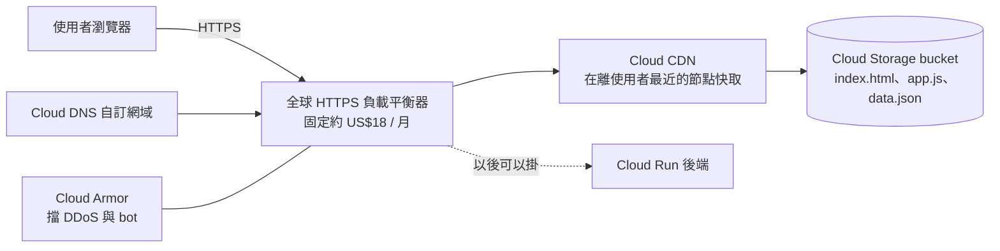
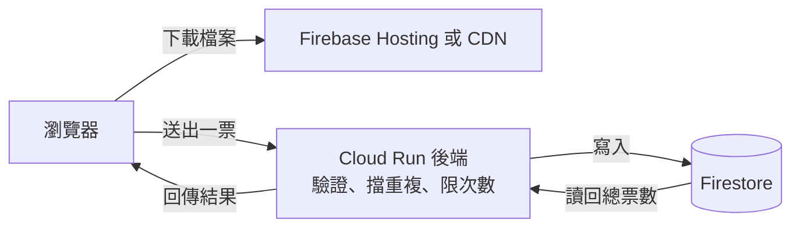
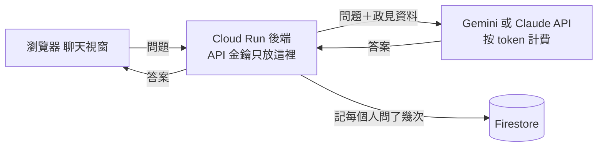

# 天空之島實作：一座「XX 島」網站怎麼做、放哪裡、搬到 GCP 要多少錢

> 成品先看：
> - Firebase Hosting 版：https://dong-dong-gcp-3.web.app
> - Cloud Run 版：https://sky-island-600195576280.asia-east1.run.app
> - 程式碼：https://github.com/aaronlee700618/sky-island

2026 年 10 月台北市長選舉，候選人陣營接連推出 3D 互動的「政策島」「施政島」，很多人跟著用 AI 做自己的島。這個 Lab 帶你拆開這類網站的結構，自己做一座、部署兩次、算清楚費用，最後看資安要顧什麼。

## 一、先搞懂：一座網站的五塊

把網站想成五座島：**瀏覽器、前端、後端、資料庫、雲端**。

| 哪一塊 | 白話 | 政策島有沒有用到 | 誰付錢 |
|---|---|---|---|
| 瀏覽器 | 觀眾手上的手機或電腦 | 有，3D 全在這裡畫 | 觀眾自己 |
| 前端 | 寫好的 HTML、JS、JSON 檔 | 有 | 0 |
| 後端 | 一直開著、幫大家做事的程式 | **沒有** | 0 |
| 資料庫 | 大家共用的那份資料 | **沒有**，設定存在瀏覽器 localStorage | 0 |
| 雲端 | 檔案放哪、誰送出去 | 有，Cloudflare 的 CDN | 免費方案 |

只亮三座、後端和資料庫是空的，所以這個 Lab 的範例網站叫「天空之島」，第一個情境叫「空島模式」。這也是為什麼十幾萬人同時逛、網站也不會掛：運算都是觀眾出的，伺服器只負責送檔案。

<callout icon="💡">
這類網站叫「靜態網站」。判斷方法只有一個：有沒有「使用者的資料要存到你這邊」。沒有，就是靜態；有，就要開後端加資料庫，錢和責任從那一刻開始。
</callout>

## 二、事前準備

- 用 **Cloud Shell** 做，不用在自己電腦裝任何東西。
- 一個自己的 GCP 專案。Firebase Hosting 沒綁信用卡也能做；Cloud Run 那段要有計費帳戶。
- 先告訴 Cloud Shell 你要用哪個專案：

```bash
gcloud config set project 你的專案ID
```

<callout icon="⚠️">
Notion 複製指令到 Cloud Shell 偶爾會夾帶看不見的字元，看到 invalid reference format 就在 Cloud Shell 裡重新框選複製一次再貼。
</callout>

## 三、步驟一：把島抓下來、先在 Cloud Shell 看一眼

```bash
cd ~
git clone https://github.com/aaronlee700618/sky-island.git
cd sky-island/site
python3 -m http.server 8080
```

按 Cloud Shell 右上角的「網頁預覽」→「透過以下通訊埠預覽：8080」，就會看到五座島漂在雲上。看完按 Ctrl + C 停掉。

<callout icon="📷">待補截圖：Cloud Shell 網頁預覽打開的天空之島</callout>

試著點一座島、切換上面三個情境，看哪幾座會亮、每月費用怎麼變。

## 四、步驟二：看懂它的結構（五分鐘）

```bash
cd ~/sky-island
ls site
ls site/vendor/three
```

- `site/index.html`、`style.css`、`app.js`：整個網站就這三支，沒有框架、沒有打包工具。
- `site/data.json`：所有文字、情境、費用都在這裡。**改這支檔案就能做自己的島**，不用碰程式。
- `site/vendor/three/`：Three.js 自己放一份，不吃別人的 CDN（資安那段會講為什麼）。
- 沒有後端程式、沒有資料庫連線、沒有 GA 追蹤碼。

小練習：用 vim 打開 `site/data.json`，把「空島模式」改成你喜歡的名字，重新整理預覽看它變了沒。

## 五、步驟三：路線一，部署到 Firebase Hosting

Firebase Hosting 是 Google 給靜態網站用的：全球 CDN、自動 HTTPS、一行指令上線。

```bash
cd ~/sky-island
export PROJECT=你的專案ID
./scripts/01_enable_apis.sh
./scripts/02_firebase_hosting.sh
```

腳本做了兩件事：把 Firebase 加進你的 GCP 專案，然後把 `site/` 資料夾上傳。結束會印出網址 `https://你的專案ID.web.app`。

<callout icon="⚠️">
Firebase 一旦加進 GCP 專案就拆不掉，只能連專案一起刪。Lab 用的專案沒關係，公司的正式專案要先想清楚。
</callout>

<callout icon="💡">
費用怎麼算：專案沒綁卡是 Spark 方案，每天 360 MB 流量免費；有綁卡會自動變 Blaze 方案，每月 10 GB 流量免費，超過約 US$0.15/GB。兩種都不收固定費。
</callout>

<callout icon="📷">待補截圖：firebase deploy 跑完印出 Hosting URL</callout>

驗證一下安全標頭有沒有生效（這是 `firebase.json` 裡設定的）：

```bash
curl -sI https://$PROJECT.web.app | grep -i -E "content-security-policy|x-content-type-options"
```

## 六、步驟四：路線二，用 Cloud Run 跑一個 nginx 容器

這條路是把網站包成容器。好處是之後要加後端，架構不用換。

```bash
cd ~/sky-island
cat Dockerfile
./scripts/03_cloud_run.sh
```

看一下 `Dockerfile`，只有四行：拿官方 nginx 映像檔、放進 nginx 設定、把 `site/` 複製進去、開 8080 埠。`--source .` 會把這個資料夾交給 Cloud Build 建映像檔，本機完全不用裝 Docker。

腳本設定了 `--min-instances 0 --max-instances 3`：沒人用的時候 0 台（不收錢），最多開到 3 台（費用有上限）。

<callout icon="⚠️">
新專案第一次用 `--source` 部署可能遇到 PERMISSION_DENIED，重跑沒用。原因是預設的運算服務帳戶少了權限，補上再跑：

```bash
PN=$(gcloud projects describe $PROJECT --format="value(projectNumber)")
gcloud projects add-iam-policy-binding $PROJECT \
  --member="serviceAccount:$PN-compute@developer.gserviceaccount.com" \
  --role="roles/run.builder"
```
</callout>

<callout icon="📷">待補截圖：Cloud Run 部署完成印出 Service URL</callout>

Cloud Run 的網址同樣有安全標頭，這次是 `nginx.conf.template` 設的，跟 Firebase 那邊一模一樣：

```bash
curl -sI $(gcloud run services describe sky-island --region asia-east1 --format="value(status.url)") | grep -i content-security-policy
```

## 七、路線三（看圖就好）：Cloud Storage + Cloud CDN + HTTPS 負載平衡器

這是 GCP「正統」的靜態網站架構，這次不做，因為前面的 Load Balancer Lab 已經做過一次。看圖理解它跟前兩條的差別：



什麼時候選它：要自訂網域加 Cloud Armor、或者同一個入口以後要同時掛靜態檔和後端 API。代價是負載平衡器有固定月費，就算沒人來也要付。

## 八、費用總表

一次完整載入約 1 MB（Three.js 壓縮後約 500 KB 加上程式和資料）。

| 方案 | 固定費 | 流量費 | 10 萬訪次（約 100 GB） | 30 萬訪次（約 300 GB） |
|---|---|---|---|---|
| Cloudflare Pages（兩座政治島用的） | 0 | 0 | 0 | 0 |
| Firebase Hosting（Blaze） | 0 | 10 GB 後約 US$0.15/GB | 約 US$14 | 約 US$44 |
| Cloud Run 跑 nginx | 0 | 約 US$0.12/GB | 約 US$12 | 約 US$36 |
| Cloud Storage + CDN + 負載平衡器 | 約 US$18 | 約 US$0.09/GB | 約 US$27 | 約 US$45 |

結論：搬到 GCP 不貴，一個月幾百到一千多台幣，主要差在負載平衡器的固定費。Cloudflare 免費又不限流量，所以兩座政治島都選它。GCP 的價值在下一段：你要開始加功能的時候。

## 九、哪些功能才要開後端和資料庫（看圖就好）

回到天空之島按「加投票功能」，後端和資料庫會亮起來。結構變成這樣：



| 功能 | 要不要後端 | 用什麼 | 費用從哪來 |
|---|---|---|---|
| 搜尋、篩選、收藏、蓋章 | 不用，瀏覽器做 | localStorage | 0 |
| 投票、留言、排行榜 | 要 | Cloud Run + Firestore | Firestore 每天 5 萬次讀、2 萬次寫內免費 |
| 分享卡圖片 | 不用 | 部署時先生成 | 0 |
| Email 通知 | 要 | 第三方寄信服務 | 按量 |

原則一句話：**使用者的資料要存到你這邊的那一刻，錢和責任同時開始。**

## 十、「問 AI 政策」聊天功能（看圖就好）

按「加 AI 問答」，多一座外島：AI 模型。不是自己養 AI，是後端把問題轉給 Gemini 或 Claude 的 API。



費用算在送進去和吐出來的字數上，主機幾乎 0。一天 1,000 次問答大約 US$1 到 5，看模型。真正會痛的是被機器人灌爆，所以後端一定要限次數。

## 十一、資安檢查表

<callout icon="🔒">
靜態網站的風險不是「被偷」，是「被改」。有了後端之後，才開始有「被偷」。
</callout>

**靜態網站（空島模式）就要做的**

- 放程式碼的 GitHub 帳號開兩步驟驗證。網站被改，九成是從這裡進去的。
- 部署用的 token 放在 GitHub Actions 的 secrets，不進程式碼。
- 第三方程式庫自己放一份（看 `site/vendor/`），不吃別人的 CDN。別人的 CDN 被換掉，你的網站跟著中毒。
- 設 Content-Security-Policy 標頭，只允許自己網域的程式跑（看 `firebase.json` 和 `nginx.conf.template`）。
- 只走 HTTPS。Firebase Hosting 和 Cloud Run 都自動給。
- DDoS：Cloudflare 免費擋；GCP 上要加 Cloud Armor，每個政策約 US$5/月起加每條規則 US$1，再按請求數計。
- 網域的 DNS 帳號也要兩步驟驗證。

**一加後端和資料庫，再加這些**

- API 金鑰、資料庫連線只能放後端。放前端等於公開。
- Firestore 要寫存取規則，預設全開等於任何人都能改票數。
- 每個人一分鐘能打幾次（rate limit）、機器人怎麼擋（驗證碼或 Cloud Armor）。
- 收 Email、投票紀錄就是個資：要有隱私權政策，GA 追蹤碼也算。

## 十二、做完記得關掉

```bash
cd ~/sky-island
./scripts/99_cleanup.sh
```

會刪掉 Cloud Run 服務、Cloud Build 建出來的映像檔，並把 Firebase Hosting 下架。Firebase 本身留在專案裡沒關係，不收固定費。

## 作業

1. 改 `site/data.json`，把五座島換成你自己的主題（例如你公司的系統、你的求職計畫），重新部署一次。
2. 把你的島的網址和截圖貼到 LINE 社群。

## 實測筆記：做的時候遇到的意外

- Cloud Shell 裡 firebase 指令已經裝好，但用非互動的 ssh 指令進去時找不到，要用 `bash -lc` 的登入 shell 才找得到。直接在 Cloud Shell 視窗打指令不會遇到。
- 在 Mac 的 zsh 用 curl 直接呼叫 Firebase API 時，`$PROJECT:addFirebase` 會被 zsh 當成變數修飾子吃掉，要寫成 `${PROJECT}:addFirebase`。Cloud Shell 是 bash，不會遇到。
- Mac 打包的 tar 檔在 Linux 解開會印一排 `LIBARCHIVE.xattr` 警告，無害，可以不理。
- 第一次把 Firebase 加進專案，Hosting 的預設網站會自動建好，名字就是專案 ID，不用另外建。
- Cloud Run 用 `--source` 部署，Cloud Build 建 nginx 映像檔大約兩到三分鐘。
